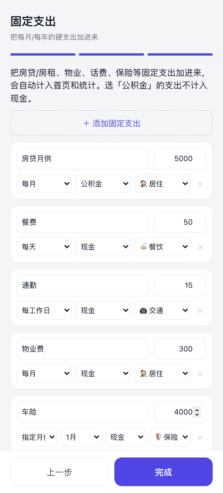
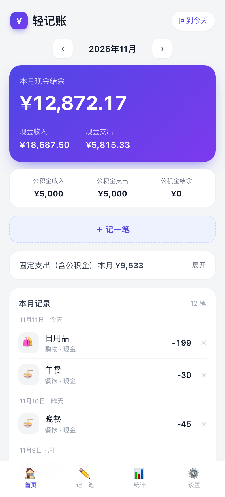
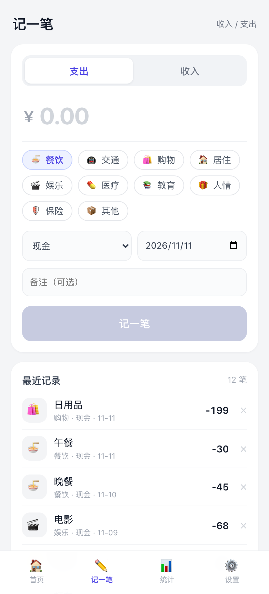
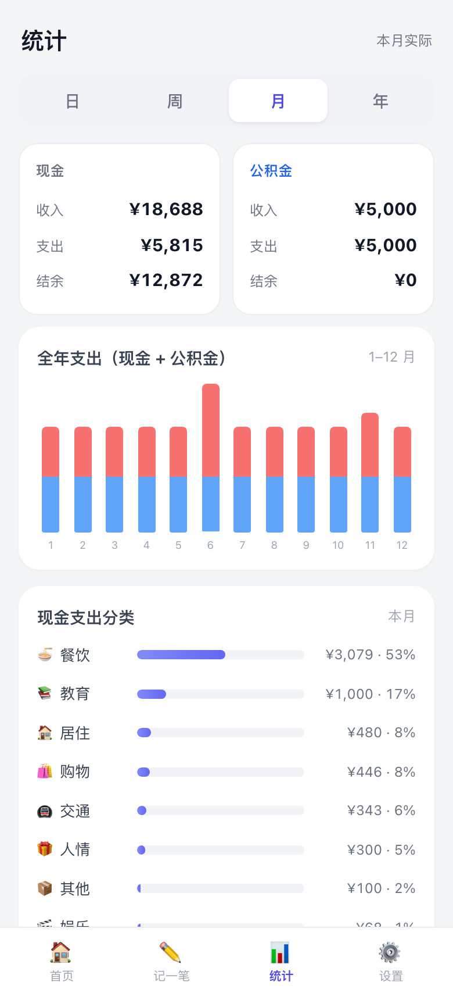
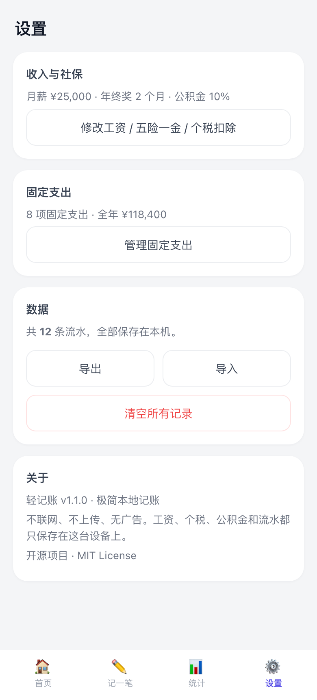

# 轻记账 · Lite Ledger

[](https://github.com/easpeeder/lite-ledger/actions/workflows/build-apk.yml)
[](https://github.com/easpeeder/lite-ledger/releases)
[](LICENSE)

极简、离线、开源的本地记账 App —— **不联网、不注册、无广告**。

首页一键记账，按日 / 周 / 月 / 年看统计，所有数据只保存在你自己的手机上。

<p align="center">
  
  
  
  
  
</p>

## 功能

- **首次启动向导**：填工资、年终奖、五险一金比例、个税专项扣除（房贷 / 子女 / 婴幼儿 / 赡养老人 / 继续教育）和固定支出，之后随时可在设置里改
- **自动算工资**：按累计预扣法算每个月个税和税后到手，年终奖可选单独计税
- **公积金独立账户**：单位和个人双边缴存自动计入公积金收入，房贷等公积金支出单独统计，不混进现金
- **固定支出**：支持每天 / 每工作日 / 每周 / 每月 / 每年 / 指定月份，数量不限；添加入口固定在列表上方，自动摊到首页和统计
- **独立的「记一笔」页面**：底部导航一级入口，金额、支出/收入、分类、账户（现金 / 公积金）、日期、备注；下方「最近记录」可直接删除
- **首页自动同步**：记一笔保存后，首页本月记录、现金/公积金结余立即更新
- **统计**：日 / 周 / 月 / 年视图，现金与公积金分别显示收入、支出、结余，全年支出柱状图和分类占比
- **本地存储**：数据存在设备本地（localStorage / WebView），不上传任何服务器
- **导入导出**：JSON 备份与恢复，工资设置、固定支出和流水一起备份
- **离线可用 / 无权限**：纯前端单页应用，Android 版不申请网络等任何权限

## 下载安装

1. 打开本仓库的 [Releases](../../releases) 页面，下载最新的 `LiteLedger.apk`
   - 也可以直接下载仓库里的 [dist/LiteLedger-1.1.1.apk](dist/LiteLedger-1.1.1.apk)
2. 在手机上点击安装；如提示，请允许「安装未知来源应用」
3. 打开即可使用，无需注册

> 在线试用网页版：<https://easpeeder.github.io/lite-ledger/> ，也可以在手机浏览器里「添加到主屏幕」。

## 从源码构建

### 网页版直接运行

```bash
cd app
python3 -m http.server 8080
# 浏览器打开 http://localhost:8080
```

也可以直接双击 `app/index.html` 打开。

### Android APK

需要 JDK 17 与 Android SDK（platform 34、build-tools 34.0.0）。

```bash
bash scripts/sync-web.sh          # 把 app/ 同步进 android/app/src/main/assets
cd android
./gradlew assembleDebug           # 产物：app/build/outputs/apk/debug/app-debug.apk
```

用 Android Studio 打开 `android/` 目录也可以直接构建。

### 用 GitHub Actions 自动打包

push 到 `main` 后，Actions 会自动构建 APK 并上传为构建产物；打 tag（如 `v1.0.0`）会自动创建 Release 并附上 APK。

## 签名（发布正式版时）

本地构建正式版：

```bash
keytool -genkeypair -keystore android/litledger-release.jks -alias litledger \
  -keyalg RSA -keysize 2048 -validity 10950
cp android/keystore.properties.example android/keystore.properties
# 编辑 keystore.properties 填入你的密码
cd android && ./gradlew assembleRelease
```

在 GitHub Actions 中签名，需要在仓库 Secrets 中配置：

| Secret | 说明 |
| --- | --- |
| `KEYSTORE_BASE64` | `base64 -i android/litledger-release.jks` 的结果 |
| `STORE_PASSWORD` | keystore 密码 |
| `KEY_ALIAS` | key 别名 |
| `KEY_PASSWORD` | key 密码 |

配置后，打 tag 构建出的就是正式签名版；未配置时工作流会回退到 debug 包（可直接安装，但不适合长期升级分发）。

> ⚠️ 请务必备份好 keystore 和密码。丢失后将无法为已安装用户推送升级包。

## 发布到 GitHub

本目录已经是一个可直接推送的 git 仓库。在 GitHub 新建一个空仓库（不要勾选初始化 README）后：

```bash
git remote add origin git@github.com:<你的用户名>/<仓库名>.git
git push -u origin main
```

发布版本时打一个 tag：

```bash
git tag v1.0.0
git push origin v1.0.0
```

Actions 会自动构建 APK 并创建 Release（带 APK 附件）。首次使用请在仓库 `Settings → Actions → General` 把 Workflow permissions 设为 **Read and write**；想同时上线网页版，在 `Settings → Pages` 把 Source 设为 **GitHub Actions**。

想发布和 `dist/` 里签名一致的正式包，请先在仓库 Secrets 配置上表中的四个变量，并妥善备份 `android/litledger-release.jks`。

## 项目结构

```
app/                网页版（也是 APK 内的前端资源）
  index.html        单页应用：首页 / 统计 / 设置
  manifest.webmanifest
  sw.js             Service Worker（离线缓存）
  icon-192.png
  icon-512.png
android/            Android WebView 壳工程
  app/src/main/assets/   构建前由 scripts/sync-web.sh 同步
.github/workflows/  自动构建 APK / 部署网页版
scripts/sync-web.sh
docs/screenshots/
```

修改前端后，记得执行 `bash scripts/sync-web.sh` 再构建 APK。

## 隐私

- App 没有 `INTERNET` 权限，从系统层面就无法联网上传
- 没有账号、没有统计 SDK、没有广告
- 所有记录保存在本机，卸载 App 即删除；请先用「设置 → 导出」备份
- 详见 [PRIVACY.md](PRIVACY.md)

## 自定义

- 应用名：`android/app/src/main/res/values/strings.xml`
- 包名：`android/app/build.gradle` 中的 `namespace` 与 `applicationId`（同时改 `MainActivity.java` 的 package）
- 主题色：`app/index.html` 顶部的 CSS 变量 `--accent`
- 分类与账户：`app/index.html` 中的 `CATS` 与 `ACCOUNTS`

## 更新日志

### v1.1.1（2026-11-11）

- 「记一笔」独立成一级页面：底部导航改为 首页 / 记一笔 / 统计 / 设置
- 首页保留「＋ 记一笔」快捷入口，保存后本月记录、现金与公积金结余自动同步
- 记一笔页面下方新增「最近记录」，最近 10 条可直接删除，首页记录同步移除
- 固定支出数量不再受限：添加入口固定在列表上方，弹层可独立滚动，可无限添加
- 修复小屏手机上添加按钮被底部操作栏遮挡、加不了第 5 条固定支出的问题

### v1.1.0（2026-11-11）

- 新增首次启动初始化向导：月薪、年终奖月数、五险一金比例、缴费基数上限、个税专项附加扣除、固定支出
- 新增工资个税引擎：累计预扣、年终奖单独/合并计税、税后到手与公积金双边缴存自动计算
- 新增现金 / 公积金双账户：公积金收入、公积金支出、公积金结余单独统计，不计入现金
- 新增固定支出：按日 / 工作日 / 周 / 月 / 年 / 指定月份录入，自动同步首页与统计
- 统计页重构：现金与公积金分列，全年支出堆叠图，分类占比
- 设置页可随时修改工资、社保、扣除项和固定支出（换工作、买房后直接改）
- 兼容 v1.0 数据：原流水自动迁移，首次打开会进入初始化向导

### v1.0.0

- 首个版本：首页记账、日/周/月/年统计、分类占比、导入导出

## License

[MIT](LICENSE)

---

## English

**Lite Ledger** is a minimal, offline, open-source expense tracker for Android (WebView) and the web. Quick add on the home screen, day/week/month/year stats, JSON backup, zero network permission, zero tracking. Download the APK from Releases or build it yourself with Gradle.
